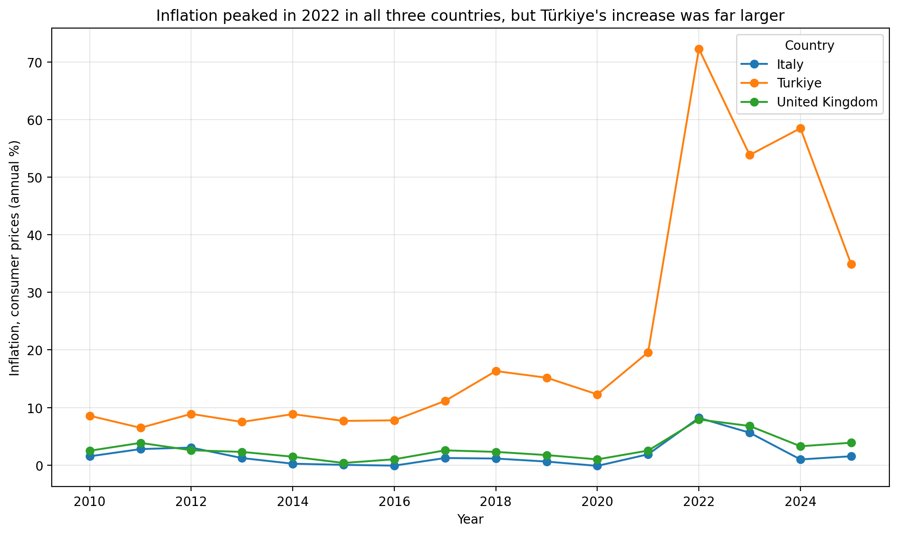
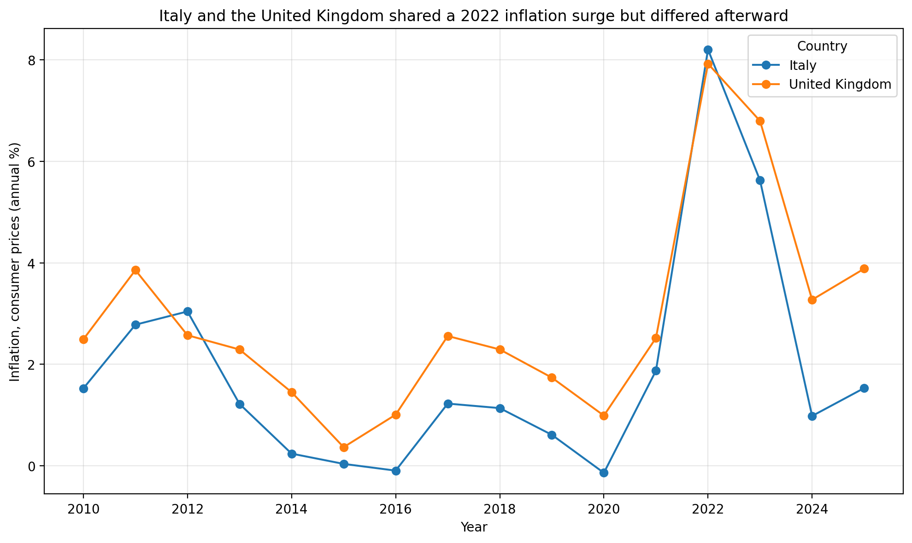
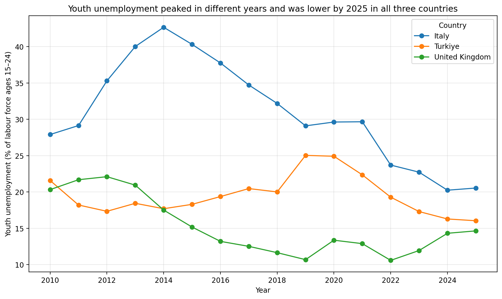

# Inflation and Youth Unemployment Across Three Countries

## Question

**How did consumer-price inflation and youth unemployment differ across Italy, Türkiye, and the United Kingdom from 2010 to the latest common year available?**

## Why this comparison matters

Inflation affects the purchasing power of households, while youth
unemployment reflects the difficulty young people face in entering the
labour market. Comparing the two measures across countries and over time
helps show whether major price increases and labour-market pressures
followed similar patterns or developed differently in each country.

## Data

The analysis uses annual observations from the World Bank Indicators API.
Inflation is measured as the annual percentage change in consumer prices.
Youth unemployment is the percentage of the labour force aged 15–24 that
is unemployed and is reported as a modelled ILO estimate.

The latest common year was derived from the available non-missing observations across all three countries and both indicators. This produced a common period of **2010–2025**.

The processed dataset contains **48 country-year observations**: 16 annual observations for each country, with inflation and youth unemployment stored in separate columns.

## Findings

### 1. Inflation peaked in 2022 in all three countries, but at very different levels

All three countries recorded their highest observed inflation rate within the 2010–2025 period in 2022. Italy reached **8.201%** and the United Kingdom reached **7.922%**, while Türkiye reached **72.309%**.

Inflation declined between 2022 and 2025 in every country. The decrease was **6.670 percentage points** in Italy, **4.039 percentage points** in the United Kingdom, and **37.428 percentage points** in Türkiye. Despite the largest decline, Türkiye still had the highest inflation rate in 2025 at **34.881%**, compared with **1.532%** in Italy and **3.883%** in the United Kingdom.

#### Closer comparison of Italy and the United Kingdom

Türkiye is excluded from the second chart only to make the lower Italian and UK values easier to compare. Türkiye’s much higher rates determine the vertical scale of the three-country chart and compress the other two series near the bottom. The complete three-country comparison remains shown above.

### 2. Youth-unemployment trajectories were more country-specific

Youth unemployment reached its highest observed value in a different year in each country:

- the United Kingdom reached **22.106%** in 2012;
- Italy reached **42.669%** in 2014;
- Türkiye reached **25.039%** in 2019.

By 2025, youth unemployment was lower than in 2010 in all three countries. The decline was **7.365 percentage points** in Italy, **5.681 percentage points** in the United Kingdom, and **5.536 percentage points** in Türkiye.

The full trajectories were not identical. Italy experienced the highest youth-unemployment rate in the dataset and then a substantial long-run decline. The United Kingdom reached its minimum before 2025 and subsequently increased, while Türkiye recorded its lowest observed value in 2025.

### 3. The two indicators did not reach their maxima in the same year

Inflation reached its highest observed value in 2022 in every country, whereas youth unemployment reached its maximum earlier. The peaks were separated by:

- **10 years** in the United Kingdom;
- **8 years** in Italy;
- **3 years** in Türkiye.

This timing comparison does not establish a relationship between the indicators. It shows only that the annual data do not display a simple pattern in which inflation and youth unemployment reach their maximum in the same year.

## Overall answer

Inflation displayed a shared cross-country timing pattern, with all three countries reaching their observed maximum in 2022, but the scale of the increase was far greater in Türkiye. Youth unemployment followed more country-specific paths, with different peak years and different movements after those peaks.

By 2025, inflation had fallen from its 2022 maximum in every country, although Türkiye’s rate remained much higher than those of Italy and the United Kingdom. Youth unemployment was lower than in 2010 in all three countries. Overall, the two indicators differed both in magnitude and timing, and their annual peaks did not coincide.

## Limitations

This analysis is descriptive and uses 16 annual observations for each country. It identifies differences, turning points, endpoint changes, and peak timing but does not estimate causal effects.

Because the indicators are annual national measures, they cannot show changes within individual years or differences between regions and population groups within each country. The peak-timing comparison therefore identifies only the calendar year of each maximum and cannot establish more precise sequencing.

Youth unemployment is a modelled ILO estimate reported through the World Bank Indicators API. Cross-country differences may also reflect structural, institutional, demographic, and labour-market conditions that are not included in this dataset.

The findings describe what occurred in these two indicators over the study period; they do not show that changes in one indicator caused changes in the other.
